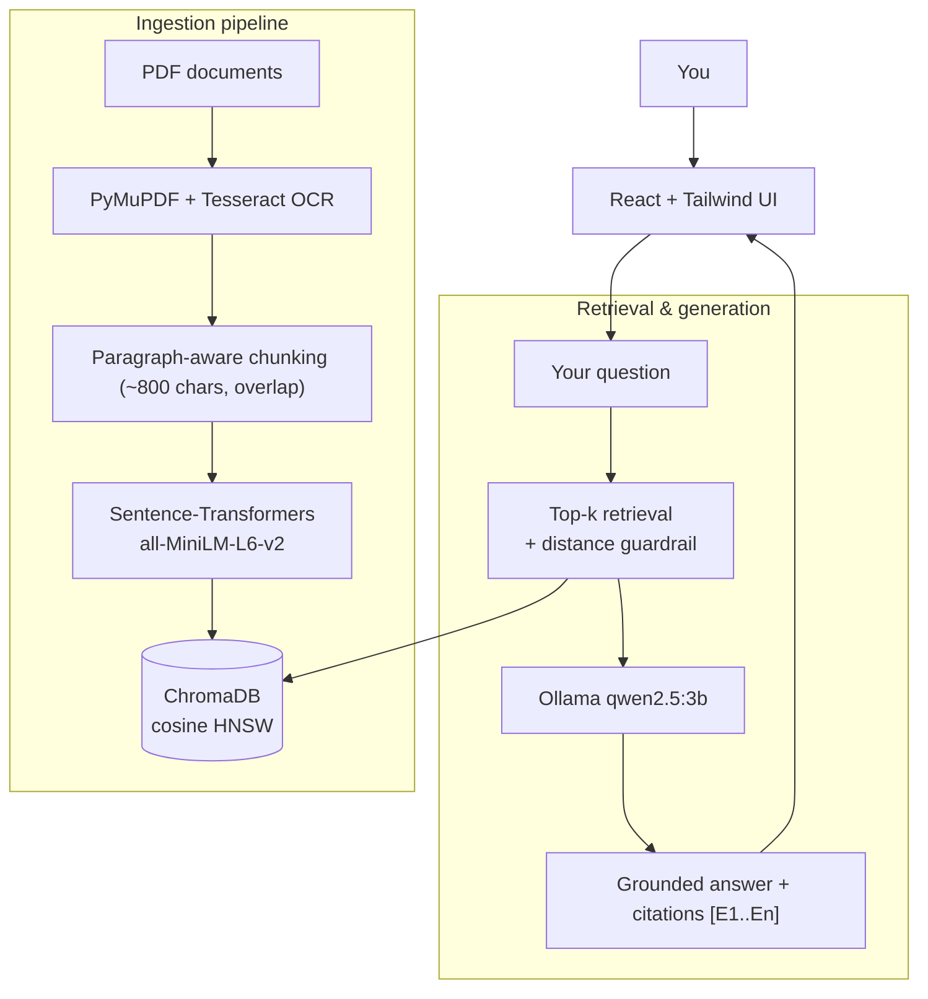

<div align="center">

# Local Multi-PDF RAG Assistant

**A fully local, citation-grounded question-answering assistant for your PDF knowledge base.**

Query, summarize, and quiz your documents — powered by a private RAG pipeline. No data ever leaves your machine.

[](https://www.python.org/)
[](https://fastapi.tiangolo.com/)
[](https://www.trychroma.com/)
[](https://ollama.com/)
[](https://react.dev/)
[](https://www.typescriptlang.org/)
[](https://tailwindcss.com/)

[](https://github.com/youssefdhouib/Local-Multi-PDF-RAG-Assistant/actions/workflows/ci.yml)
[](https://opensource.org/licenses/MIT)
[](https://github.com/youssefdhouib/Local-Multi-PDF-RAG-Assistant/pulls)

[Highlights](#highlights) · [Demo](#demo) · [Screenshots](#screenshots) · [How it works](#how-it-works) · [Tech stack](#tech-stack) · [Getting started](#getting-started) · [API reference](#api-reference) · [Project structure](#project-structure)

</div>

---

## Highlights

- **Fully private & local** — extraction, embeddings, and generation all run on your machine (Ollama + Sentence-Transformers). Nothing is sent to the cloud.
- **PDF ingestion with OCR fallback** — PyMuPDF text extraction, with Tesseract OCR for scanned or text-poor pages (EN/FR/AR/DE/ES). Unstructured is tried first only if it is installed with its PDF extras (`pip install "unstructured[pdf]"`); otherwise the app falls back to PyMuPDF and logs why.
- **Semantic chunking** — paragraph-aware chunks (~800 chars) with character-level overlap so context survives chunk boundaries.
- **Persistent vector index** — ChromaDB with HNSW + cosine distance, plus SHA-256 fingerprinting to prevent duplicate uploads.
- **Citation-grounded answers** — each document answer comes with a sources panel listing the exact chunks (document, page, chunk) that were given to the model; if the best match is below a cosine-distance threshold, the assistant says it could not find the answer and shows no sources.
- **Beyond Q&A** — structured document/library summaries, MCQ quiz generation, and Markdown / PDF export.
- **Intent-aware routing** — an LLM classifier sends small talk to chat mode and content questions to the RAG pipeline.
- **Modern UI** — React 19 + Tailwind CSS + shadcn/ui with dark-ready design and an onboarding flow.

## Demo

[](docs/demo.mp4)

Add a short walkthrough to `docs/demo.mp4` — upload a PDF, chat with citations, generate a summary, and run a quiz. *(Thumbnail is a placeholder.)*

## Screenshots

<div align="center">
  
  
  
  
</div>

Replace the placeholders with your own captures in [`docs/screenshots/`](docs/screenshots/).

---

## How it works



| # | Phase | What happens |
|---|---|---|
| 1 | **Ingest** | Text is extracted with PyMuPDF; pages that are scanned or nearly empty are sent to Tesseract OCR when it is installed. (Unstructured is used first only if its PDF extras are installed.) |
| 2 | **Chunk** | Pages are normalized and split into paragraph-aware chunks (~800 chars) with overlap, preserving meaning and page provenance. |
| 3 | **Embed** | Chunks are embedded with `all-MiniLM-L6-v2` and upserted into a persistent ChromaDB collection. |
| 4 | **Retrieve** | The question is embedded and matched against the index; top-`k` chunks must pass a cosine-distance guardrail. |
| 5 | **Answer** | Ollama `qwen2.5:3b` writes a Markdown answer grounded strictly in the retrieved evidence; the UI renders clickable citations. |
| 6 | **Extend** | The same evidence powers summaries, MCQs, and Markdown/PDF exports. |

## Tech stack

| Layer | Technology |
|---|---|
| Backend | Python · FastAPI · Uvicorn |
| Vector store | ChromaDB (persistent, cosine HNSW) |
| Embeddings | Sentence-Transformers `all-MiniLM-L6-v2` |
| LLM | Ollama — `qwen2.5:3b` by default (any Ollama model via `OLLAMA_MODEL`) |
| PDF parsing | PyMuPDF · Tesseract OCR (optional) · Unstructured (optional) · langdetect |
| Frontend | React 19 · Vite · TypeScript · Tailwind CSS · shadcn/ui |
| Export | jsPDF / ReportLab · Markdown |

## Getting started

### Prerequisites

- **Python 3.12** and **Node.js ≥ 20**
- **Ollama** with the default model pulled (`qwen2.5:3b`, ~1.9 GB, fits a 4 GB GPU):

  ```bash
  ollama pull qwen2.5:3b
  ```

- **Tesseract OCR** on your `PATH` (optional). Without it, scanned or image-only pages are skipped (a warning is logged) and the rest of the PDF is still indexed.

### 1. Backend

```bash
cd backend
python -m venv .venv
.venv\Scripts\activate            # Windows
source .venv/bin/activate         # macOS / Linux

pip install -r ../requirements.txt
uvicorn web_server:app --reload --port 8000
```

Optional settings (environment variables): `OLLAMA_MODEL` (default `qwen2.5:3b`; e.g. `llama3.2` also works), `OLLAMA_URL` (default `http://localhost:11434`), `MAX_UPLOAD_MB` (default `50`), `CORS_ORIGINS` (default `http://localhost:5173,http://127.0.0.1:5173`), `TESSERACT_CMD` (path to `tesseract.exe` if it is not on `PATH`; the standard Windows install folder is detected automatically), `OCR_LANGS` (default `fra+eng`; languages that are not installed are skipped with a warning — add French by copying `fra.traineddata` into Tesseract's `tessdata` folder).

The API is now live at `http://localhost:8000` — interactive docs at [`http://localhost:8000/docs`](http://localhost:8000/docs). Upload PDFs from the UI (files copied manually into `backend/data/` are not indexed until uploaded).

Evaluate the pipeline end to end (needs Ollama; indexes `backend/eval/sample_pdfs/` into a temporary folder, your data is not touched):

```bash
cd backend
python eval/run_eval.py
```

Run the tests (from the repository root):

```bash
pip install -r requirements-dev.txt
pytest
```


### 2. Frontend

```bash
cd frontend
npm install
npm run dev
```

Open [`http://localhost:5173`](http://localhost:5173) — the UI is wired to the backend at `http://localhost:8000`.

### 3. Test it

```bash
pytest                      # unit tests (backend/tests)
cd frontend && npm run lint && npm run build
```

## API reference

| Method | Endpoint | Description |
|---|---|---|
| `GET` | `/api/health` | Service health check |
| `GET` | `/api/documents` | List indexed documents with status |
| `POST` | `/api/upload` | Upload + ingest a PDF (background) |
| `POST` | `/api/delete` | Remove a document from index & disk |
| `POST` | `/api/reindex` | Re-ingest an existing document |
| `POST` | `/api/chat` | RAG Q&A (or chat mode) with citations |
| `POST` | `/api/summary/document` | Structured summary of one document |
| `POST` | `/api/summary/library` | Summary across the whole library |
| `POST` | `/api/quiz/document` | MCQ quiz for one document |
| `POST` | `/api/quiz/library` | MCQ quiz across the library |

## Project structure

```
├── .github/workflows/       # CI: frontend lint + build, backend unit tests
├── backend/                 # Python RAG engine + FastAPI API
│   ├── ingest/              # Extraction (PyMuPDF + OCR, optional Unstructured), chunking, ingestion service
│   ├── features/            # Summaries, MCQ quiz, exports, intent router
│   ├── scripts/             # Ollama connectivity checks
│   ├── tests/               # Unit tests + manual integration scripts
│   ├── rag_answer.py        # Retrieval + grounded answer generation
│   └── web_server.py        # FastAPI application (the API layer)
├── frontend/                # React + Vite + TypeScript + Tailwind + shadcn/ui
│   └── src/
│       ├── pages/           # Chat, Documents, Summary, Quiz, Onboarding
│       ├── contexts/        # User / Document / Chat providers
│       └── lib/             # API client, Markdown & PDF export helpers
├── docs/                    # Demo video + screenshots
├── requirements.txt
└── README.md
```

## Contributing

Contributions are welcome. Open an issue to discuss changes, then submit a pull request on a feature branch. Keep commit messages in [Conventional Commits](https://www.conventionalcommits.org/) style.

## License

Distributed under the [MIT License](LICENSE).