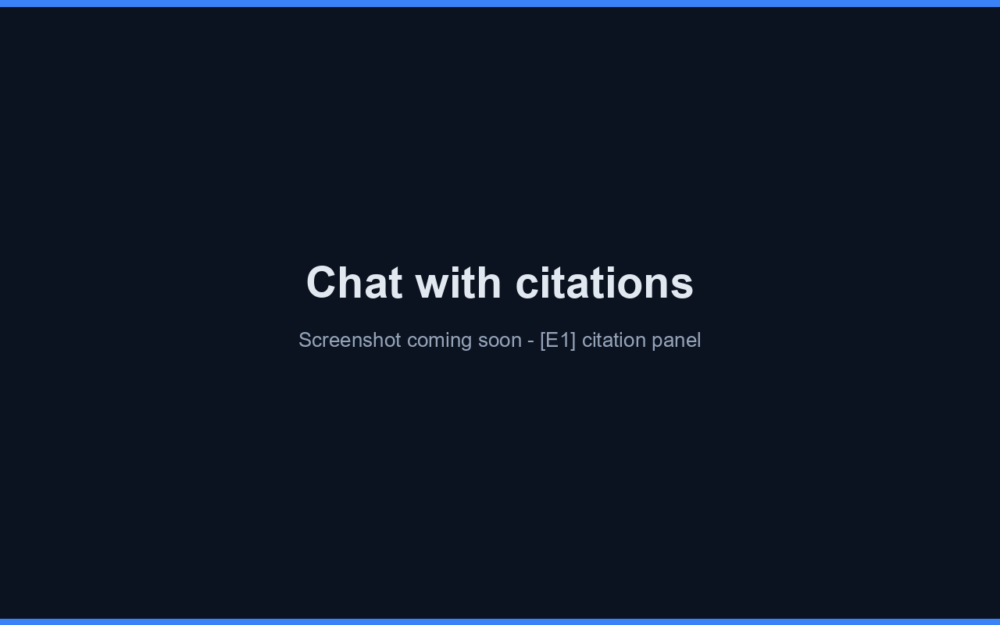

<div align="center">

# Local Multi-PDF RAG Assistant

**A fully local, citation-grounded question-answering assistant for your PDF knowledge base.**
Build, query, and export from a private RAG pipeline — no data ever leaves your machine.

[](https://www.python.org/)
[](https://fastapi.tiangolo.com/)
[](https://www.trychroma.com/)
[](https://ollama.com/)
[](https://react.dev/)
[](https://www.typescriptlang.org/)
[](https://tailwindcss.com/)

[](https://github.com/youssefdhouib/Local-Multi-PDF-RAG-Assistant/actions/workflows/ci.yml)
[](https://opensource.org/licenses/MIT)

</div>

---

## Demo

<div align="center">
  <video src="https://github.com/youssefdhouib/Local-Multi-PDF-RAG-Assistant/raw/main/docs/demo.mp4" controls loop width="720"></video>
  <br />
  <em>Add a short walkthrough video to <code>docs/demo.mp4</code> covering upload, chat with citations, summary, and quiz generation.</em>
</div>

## Screenshots

<div align="center">
  
  
  
  
</div>

> Screenshots live in [`docs/screenshots/`](docs/screenshots/). Replace the placeholders with your own captures.

---

## Highlights

- **Fully private & local** — every step (extraction, embeddings, generation) runs on your machine via Ollama and Sentence-Transformers.
- **Hybrid PDF ingestion** — Unstructured parsing with an automatic PyMuPDF + Tesseract OCR fallback for scanned or multilingual pages (EN/FR/AR/DE/ES).
- **Semantic chunking** — paragraph-aware chunks (~800 chars) with character-level overlap so context survives across chunk boundaries.
- **Persistent vector index** — ChromaDB with HNSW + cosine distance, plus SHA-256 fingerprinting to avoid duplicate uploads.
- **Citation-grounded answers** — every response references `[E1]…[En]` with document, page, chunk, and distance, and a relevance guardrail rejects low-confidence retrieval to reduce hallucination.
- **Beyond Q&A** — structured document/library summaries, an MCQ quiz generator, and Markdown / PDF export for all of it.
- **Intent-aware routing** — an LLM classifier sends small talk to chat mode and content questions to the RAG pipeline.

## How it works

```mermaid
flowchart LR
    U[User] --> UI[React + Tailwind UI]
    UI -->|REST /api| API[FastAPI Backend]
    API --> ING[Ingestion Pipeline]
    ING --> EX[Unstructured + OCR fallback]
    EX --> CH[Semantic Chunking]
    CH --> EM[Sentence-Transformers<br/>all-MiniLM-L6-v2]
    EM --> DB[(ChromaDB<br/>cosine HNSW)]
    UI --> Q[Query]
    Q --> RET[Top-k retrieval<br/>+ distance guardrail]
    RET --> DB
    RET --> LLM[Ollama llama3.2]
    LLM --> A[Answer + citations [E1..En]]
    A --> UI
```

1. **Ingest** — a PDF is uploaded, parsed by Unstructured, and automatically routed to an OCR pipeline (PyMuPDF + Tesseract) if a page is scanned or weak.
2. **Chunk** — pages are normalized and split into paragraph-aware chunks with overlap, keeping meaning and page provenance intact.
3. **Embed** — chunks are embedded with `all-MiniLM-L6-v2` (normalized) and upserted into a persistent ChromaDB collection.
4. **Retrieve** — a question is embedded and matched against the index; the best `top-k` chunks are filtered by a cosine distance guardrail.
5. **Answer** — Ollama `llama3.2` writes a Markdown answer grounded strictly in the retrieved evidence; the UI renders clickable citations.
6. **Extend** — the same evidence powers summaries, MCQs, and Markdown/PDF exports.

## Tech stack

| Layer | Technology |
|---|---|
| Backend | Python · FastAPI · Uvicorn |
| Vector store | ChromaDB (persistent, cosine HNSW) |
| Embeddings | Sentence-Transformers `all-MiniLM-L6-v2` |
| LLM | Ollama — `llama3.2` (local) |
| PDF parsing | Unstructured · PyMuPDF · Tesseract OCR · langdetect |
| Frontend | React 19 · Vite · TypeScript · Tailwind CSS · shadcn/ui |
| Export | jsPDF / ReportLab · Markdown |

## Getting started

### Prerequisites

- **Python 3.12** and **Node.js ≥ 20**
- **Ollama** with Llama 3.2 pulled:

  ```bash
  ollama pull llama3.2
  ```

- **Tesseract OCR** installed and on your `PATH` (only needed for scanned PDFs; text-based PDFs work without it).

### 1. Backend

```bash
cd backend
python -m venv .venv
.venv\Scripts\activate            # Windows
source .venv/bin/activate         # macOS / Linux

pip install -r ../requirements.txt
uvicorn web_server:app --reload --port 8000
```

The API is now live at `http://localhost:8000` — interactive docs at [`http://localhost:8000/docs`](http://localhost:8000/docs).

Drop PDFs into `backend/data/` or upload them later through the UI.

### 2. Frontend

```bash
cd frontend
npm install
npm run dev
```

Open [`http://localhost:5173`](http://localhost:5173) — the UI is wired to the backend at `http://localhost:8000`.

### 3. Test it

```bash
pytest                      # unit tests (backend/tests)
cd frontend && npm run build && npm run lint
```

## API reference

| Method | Endpoint | Description |
|---|---|---|
| `GET` | `/api/health` | Service health check |
| `GET` | `/api/documents` | List indexed documents with status |
| `POST` | `/api/upload` | Upload + ingest a PDF (background) |
| `POST` | `/api/delete` | Remove a document from index & disk |
| `POST` | `/api/reindex` | Re-ingest an existing document |
| `POST` | `/api/chat` | RAG Q&A (or chat mode) with citations |
| `POST` | `/api/summary/document` | Structured summary of one document |
| `POST` | `/api/summary/library` | Summary across the whole library |
| `POST` | `/api/quiz/document` | MCQ quiz for one document |
| `POST` | `/api/quiz/library` | MCQ quiz across the library |

## Project structure

```
├── .github/workflows/       # CI: frontend lint+build, backend unit tests
├── backend/                 # Python RAG engine + FastAPI API
│   ├── ingest/              # Hybrid extraction (Unstructured + OCR), chunking, ingestion service
│   ├── features/            # Summaries, MCQ quiz, exports, intent router
│   ├── scripts/             # Ollama connectivity checks
│   ├── tests/               # Unit tests + manual integration scripts
│   ├── rag_answer.py        # Retrieval + grounded answer generation
│   └── web_server.py        # FastAPI application (the API layer)
├── frontend/                # React + Vite + TypeScript + Tailwind + shadcn/ui
│   └── src/
│       ├── pages/           # Chat, Documents, Summary, Quiz, Onboarding
│       ├── contexts/        # User / Document / Chat providers
│       └── lib/             # API client, Markdown & PDF export helpers
├── docs/                    # Demo video + screenshots
├── requirements.txt
└── README.md
```

## Roadmap

- [x] Hybrid PDF ingestion with OCR fallback
- [x] Persistent vector index with deduplication
- [x] Citation-grounded Q&A + intent router
- [x] Summaries, quizzes, Markdown/PDF export
- [ ] Streaming chat responses (SSE)
- [ ] Cross-encoder reranking for retrieval quality
- [ ] Docker Compose one-command setup
- [ ] Optional configurable embedding backend (local or API)

## License

Distributed under the [MIT License](LICENSE). See `LICENSE` for details.