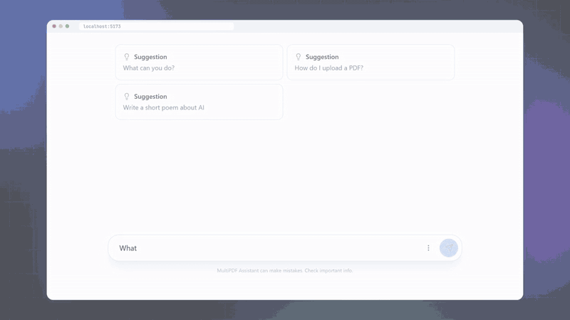
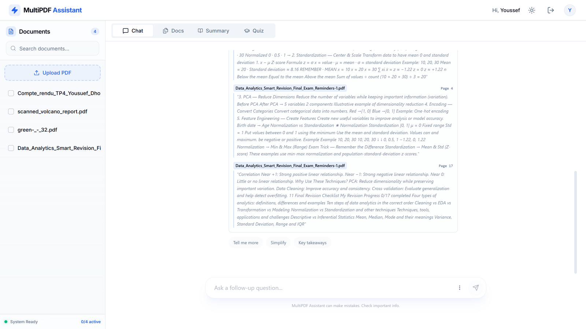
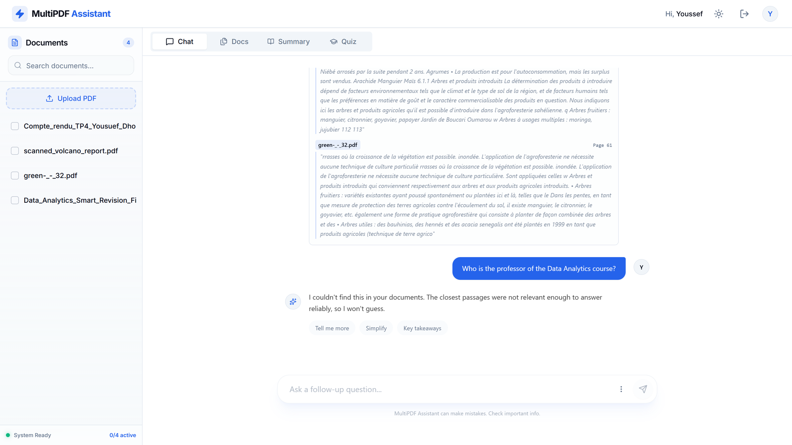
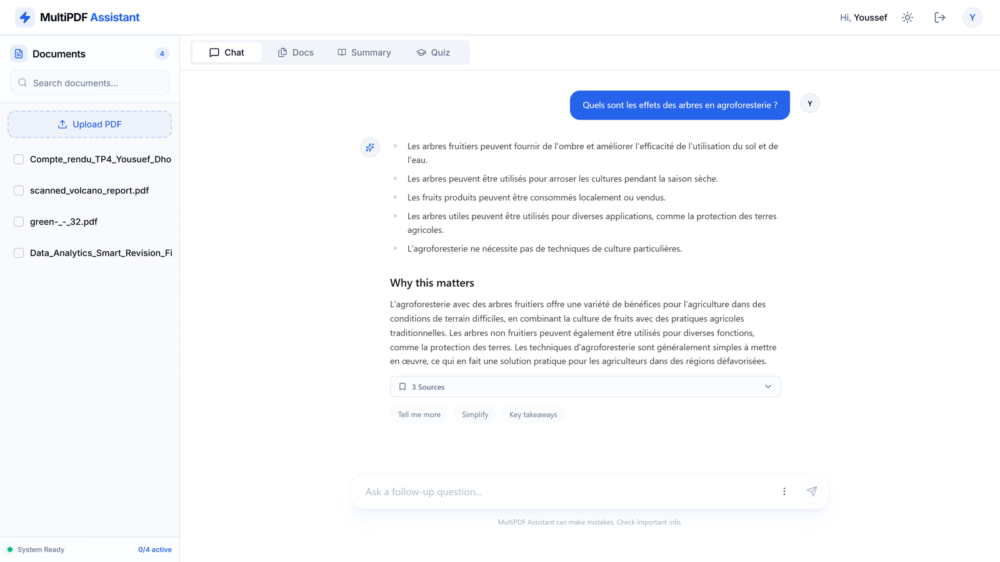
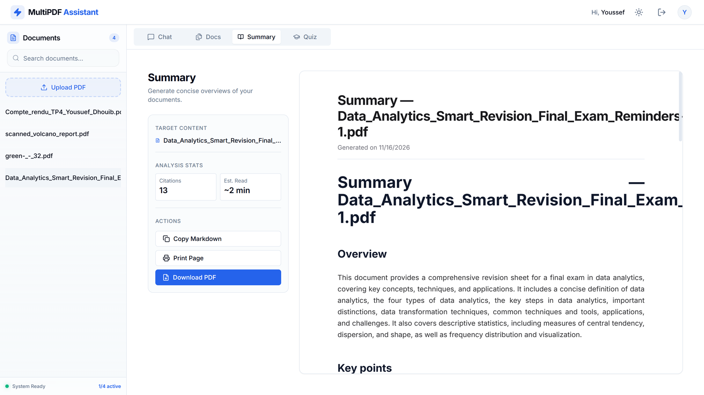
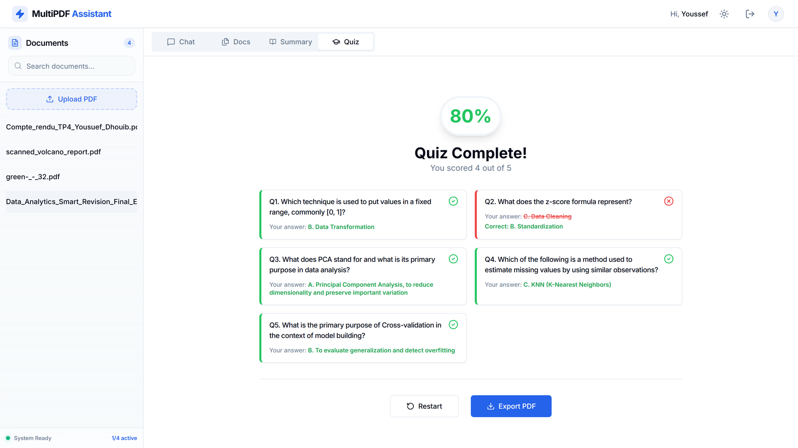
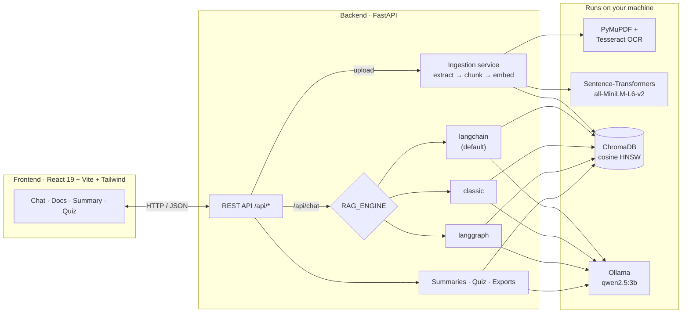
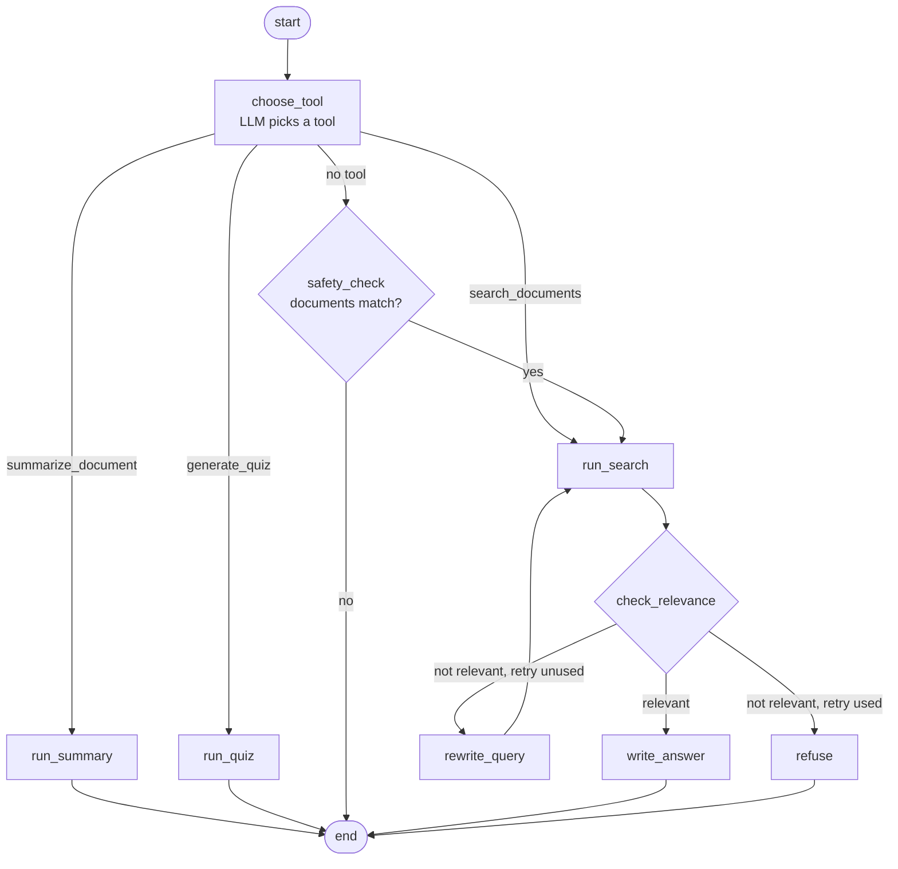

<div align="center">


# Local Multi-PDF RAG Assistant

**Chat with your PDFs, 100% on your machine.**<br/>
Ask questions, get answers with the exact document and page, summarize, and quiz yourself.<br/>
When the answer is not in your documents, it says so instead of guessing.

[](https://github.com/youssefdhouib/Local-Multi-PDF-RAG-Assistant/actions/workflows/ci.yml)
[](LICENSE)
[](https://www.python.org/)
[](https://fastapi.tiangolo.com/)
[](https://www.langchain.com/)
[](https://www.langchain.com/langgraph)
[](https://www.trychroma.com/)
[](https://ollama.com/)
[](https://react.dev/)
[](https://www.typescriptlang.org/)

[Demo](#-demo) · [Features](#-features) · [Screenshots](#-screenshots) · [Architecture](#-architecture) · [Evaluation](#-evaluation) · [Getting started](#-getting-started) · [API](#-api-reference) · [Limitations](#-known-limitations)

</div>

---

## 🎬 Demo

<div align="center">

<video src="https://github.com/youssefdhouib/Local-Multi-PDF-RAG-Assistant/raw/docs/readme-refresh/docs/demo.mp4" controls muted width="100%"></video>

<a href="docs/demo.mp4"></a>

<sub>78 seconds, real app and real answers: onboarding → upload → chat with sources → French question → honest refusal → summary → quiz → the LangGraph workflow.</sub>



</div>

## ✨ Features

| | |
|---|---|
| 🔒 **Private by design** | Text extraction, embeddings, the vector database and the LLM all run locally (Ollama + Sentence-Transformers + ChromaDB). No API keys, nothing sent to the cloud. |
| 📄 **Any PDF, even scanned** | PyMuPDF extraction with a Tesseract OCR fallback for scanned or image-only pages. Paragraph-aware chunks (~800 characters, with overlap) keep the page of every passage. Duplicate uploads are detected with a SHA-256 fingerprint. |
| 📌 **Answers with sources** | Every document answer lists the passages given to the model: document name, page and the quoted text. |
| 🙅 **No guessing** | If no passage is close enough (cosine distance above 0.75), or the LangGraph relevance check says the evidence does not contain the answer, the assistant refuses and shows no sources. |
| 🧭 **Three Q&A engines** | `langchain` (default, LCEL chain), `classic` (hand-written pipeline, kept for rollback) and `langgraph` (tool calling + one bounded retry). One setting switches between them; the API and UI stay the same. |
| 📝 **Summaries** | Structured summary of one document or the whole library, with citations; copy as Markdown, print, or download as PDF. |
| 🎓 **Quizzes** | Multiple-choice questions generated from a document, with explanations and the source page; export the results as PDF. |
| 🗂️ **Document library** | Upload, select, re-index and delete PDFs; select documents to limit chat to them. |
| ✅ **Tested and evaluated** | 63 unit tests (no GPU or Ollama needed, fake models) run in CI on every push, plus an end-to-end evaluation script with real numbers below. |

## 📸 Screenshots

<table>
  <tr>
    <td width="50%"><p align="center"><b>Chat</b>: a grounded answer to a question about a 17-page revision sheet</p></td>
    <td width="50%"><p align="center"><b>Sources</b>: the passages used, with document and page</p></td>
  </tr>
  <tr>
    <td><p align="center"><b>No guessing</b>: an off-topic question gets an honest refusal</p></td>
    <td><p align="center"><b>French too</b>: a question about a 67-page French guide</p></td>
  </tr>
  <tr>
    <td><p align="center"><b>Library</b>: upload, index and select PDFs (a scanned report included)</p></td>
    <td><p align="center"><b>Summary</b>: cited overview with Markdown and PDF export</p></td>
  </tr>
  <tr>
    <td><p align="center"><b>Quiz</b>: instant feedback with an explanation and the source</p></td>
    <td><p align="center"><b>Results</b>: score and review of every answer</p></td>
  </tr>
</table>

## 🏗️ Architecture



| # | Step | What happens |
|---|---|---|
| 1 | **Ingest** | Text is extracted with PyMuPDF; scanned or nearly empty pages go to Tesseract OCR when it is installed (Unstructured is tried first only if its PDF extras are installed). |
| 2 | **Chunk** | Pages are cleaned and split into paragraph-aware chunks (~800 characters) with overlap, keeping the page number of every chunk. |
| 3 | **Embed + store** | Chunks are embedded with `all-MiniLM-L6-v2` and stored in a persistent ChromaDB collection (cosine distance). |
| 4 | **Retrieve** | The question is embedded; the top-`k` chunks must pass a distance threshold (0.75), optionally only inside the selected documents. |
| 5 | **Answer** | Ollama `qwen2.5:3b` writes a Markdown answer using only the retrieved evidence; the UI shows the sources. |
| 6 | **Reuse** | The same index powers summaries, quizzes and the Markdown / PDF exports. |

### Q&A engines

Document Q&A runs on one of three interchangeable pipelines, chosen with `RAG_ENGINE`. All three return the same answer + sources shape, so the API and the UI do not change.

| | `classic` ([`rag_answer.py`](backend/rag_answer.py)) | `langchain` ([`langchain_rag.py`](backend/langchain_rag.py)), default | `langgraph` ([`graph_rag.py`](backend/graph_rag.py)) |
|---|---|---|---|
| Retrieval | direct ChromaDB query | LangChain `Chroma` store on the **same index** | same as `langchain`, keeps the UI document filter |
| LLM call | HTTP to Ollama `/api/generate` | `ChatOllama` in an LCEL chain: `prompt \| llm \| StrOutputParser()` | `ChatOllama.bind_tools` picks a tool, then the same LCEL answer chain |
| Relevance rules | shared `select_evidence()` | shared `select_evidence()` | `select_evidence()` + an LLM yes/no relevance check |
| Extra | — | prompt templates, swappable components, fake models for tests | summary and quiz as tools, one retry with a rewritten query |

LangChain does not make answers more accurate by itself; it gives standard, swappable building blocks. To roll back, start the API with `RAG_ENGINE=classic`. Summaries, quizzes and intent routing use the classic code in every mode.

### LangGraph workflow (tool calling + one retry)

`RAG_ENGINE=langgraph` answers `/api/chat` with one small LangGraph `StateGraph`. The model makes **one** tool choice; the graph then checks the evidence and may search **once more** with a rewritten query before refusing:



| Step | What it does | Reuses |
|---|---|---|
| `choose_tool` | `ChatOllama.bind_tools` with 3 tools: `search_documents` (default for facts), `summarize_document`, `generate_quiz` | — |
| `safety_check` | if the model answered without a tool but the documents clearly match, search anyway | `has_relevant_evidence()` |
| `run_search` | top-k chunks with the user's document filter (the model never sets the filter) | `retrieve_with_langchain()`, `select_evidence()` |
| `check_relevance` | no chunk under the distance threshold → not relevant (no LLM call); otherwise one small yes/no LLM check "does the evidence contain the answer?" (only a clear "no" rejects) | — |
| `rewrite_query` | at most once: search again with other words; the answer still uses the original question | — |
| `write_answer` / `refuse` | the LCEL answer chain / the usual refusal with no sources | `generate_answer()` |
| `run_summary` / `run_quiz` | check the document name (must exist and be in the UI selection), cap quizzes at 10 questions, then call the existing features | `summarize_document()`, `generate_mcqs_for_document()` |

No memory, no agent loop, no multi-agent: one decision, one bounded retry. The diagram can be regenerated with `graph_rag.GRAPH.get_graph().draw_mermaid()`.

## 📊 Evaluation

`backend/eval/run_eval.py` indexes the sample PDFs into a temporary folder and asks the same questions to each engine (`qwen2.5:3b`, 2 runs per engine):

| | classic | langchain (default) | langgraph |
|---|---|---|---|
| Answer accuracy (14 in-scope) | 14, 14 | 13, 14 | 13, 13 |
| False refusals | 0, 0 | 0, 0 | 1, 1 |
| Off-topic refused (11) | 10, 9 | 8, 7 | **11, 11** |
| "How many moons does Saturn have?" refused | no, no | no, no | **yes, yes** |
| Paraphrased questions (3) | 2, 2 | 2, 2 | 2, 2 |
| Tool choice (14, after safety check) | – | – | 13, 13 |
| Avg latency (in-scope) | 1.7 s, 1.6 s | 1.9 s, 2.0 s | 4.0 s, 3.6 s |

What this shows, honestly: the relevance check stops answers built from the wrong evidence (e.g. "How many moons does Saturn have?" answered from the Jupiter page, or a Venus temperature taken from the model's memory), which classic and langchain still do (Saturn in every run). The cost is about 2 s more per answer and one recurring false refusal ("What are the names of the moons of Mars?"). The one retry ran (mostly on off-topic questions) but did not rescue any answer in these runs: the relevance check is what made the difference. An answer counts as a refusal only if it starts with one (first 150 characters). With small sample sizes (14 / 11 questions) these numbers show a direction, not a guarantee. `langchain` stays the default.

## 🚀 Getting started

### Prerequisites

- **Python 3.12** and **Node.js 20+**
- **Ollama** with the default model (`qwen2.5:3b`, ~1.9 GB, fits a 4 GB GPU):

  ```bash
  ollama pull qwen2.5:3b
  ```

- **Tesseract OCR** on your `PATH` (optional). Without it, scanned or image-only pages are skipped with a warning and the rest of the PDF is still indexed.

### 1. Backend

```bash
cd backend
python -m venv .venv
.venv\Scripts\activate            # Windows
source .venv/bin/activate         # macOS / Linux

pip install -r ../requirements.txt
uvicorn web_server:app --reload --port 8000
```

The API runs at `http://localhost:8000`, with interactive docs at [`http://localhost:8000/docs`](http://localhost:8000/docs). Upload PDFs from the UI (files copied by hand into `backend/data/` are not indexed until uploaded).

### 2. Frontend

```bash
cd frontend
npm install
npm run dev
```

Open [`http://localhost:5173`](http://localhost:5173). The UI talks to the backend at `http://localhost:8000`.

### 3. Tests and evaluation

```bash
pip install -r requirements-dev.txt
pytest                                         # 63 unit tests, no Ollama or GPU needed

cd backend
python eval/run_eval.py                        # end-to-end evaluation (needs Ollama), default engine
RAG_ENGINE=langgraph python eval/run_eval.py   # or classic

cd ../frontend && npm run lint && npm run build
```

The evaluation works in a temporary folder: your own documents and index are never touched.

### Configuration

All settings are optional environment variables for the backend:

| Variable | Default | Description |
|---|---|---|
| `RAG_ENGINE` | `langchain` | Q&A engine: `langchain`, `classic` (rollback) or `langgraph` (tool calling + one retry) |
| `OLLAMA_MODEL` | `qwen2.5:3b` | Any Ollama model, e.g. `llama3.2` |
| `OLLAMA_URL` | `http://localhost:11434` | Ollama server |
| `MAX_UPLOAD_MB` | `50` | Maximum PDF size |
| `CORS_ORIGINS` | `http://localhost:5173,http://127.0.0.1:5173` | Origins allowed to call the API |
| `TESSERACT_CMD` | auto | Path to `tesseract.exe` if it is not on `PATH` (the standard Windows install folder is detected) |
| `OCR_LANGS` | `fra+eng` | OCR languages; languages that are not installed are skipped with a warning |

## 🔌 API reference

| Method | Endpoint | Description |
|---|---|---|
| `GET` | `/api/health` | Service health and active engine |
| `GET` | `/api/documents` | List indexed documents with status |
| `POST` | `/api/upload` | Upload a PDF and index it in the background |
| `POST` | `/api/delete` | Remove a document from the index and the disk |
| `POST` | `/api/reindex` | Re-index an existing document |
| `POST` | `/api/chat` | Q&A (or small talk) with sources |
| `POST` | `/api/summary/document` | Structured summary of one document |
| `POST` | `/api/summary/library` | Summary across the whole library |
| `POST` | `/api/quiz/document` | MCQ quiz for one document |
| `POST` | `/api/quiz/library` | MCQ quiz across the library |

## 🗂️ Project structure

```
├── .github/workflows/       # CI: frontend lint + build, backend unit tests
├── backend/                 # Python RAG engine + FastAPI API
│   ├── ingest/              # Extraction (PyMuPDF + OCR, optional Unstructured), chunking, ingestion service
│   ├── features/            # Summaries, MCQ quiz, exports, intent router, embeddings, Ollama client
│   ├── scripts/             # Ollama connectivity checks
│   ├── tests/               # Unit tests + manual integration scripts
│   ├── eval/                # End-to-end evaluation (sample PDFs + questions)
│   ├── rag_answer.py        # Classic pipeline + shared relevance rules
│   ├── langchain_rag.py     # LangChain pipeline (default engine)
│   ├── graph_rag.py         # LangGraph workflow: tool calling + one retry
│   └── web_server.py        # FastAPI application (the API layer)
├── frontend/                # React + Vite + TypeScript + Tailwind + shadcn/ui
│   └── src/
│       ├── pages/           # Chat, Documents, Summary, Quiz, Onboarding
│       ├── contexts/        # User / Document / Chat providers
│       └── lib/             # API client, Markdown & PDF export helpers
├── docs/                    # Demo video, screenshots, logo
├── requirements.txt
└── README.md
```

## ⚠️ Known limitations

Measured while testing, kept here on purpose:

- **English embedding model.** `all-MiniLM-L6-v2` is trained on English, so retrieval is weaker on French documents (some French questions were refused although the answer was in the PDF).
- **Context window.** Ollama uses a 4,096-token context by default, so a summary of a long PDF only sees its first pages.
- **No conversation memory.** Each question is answered on its own; follow-ups like "and how tall is it?" need the full question.
- **Parallel uploads on a fresh server.** Uploading several PDFs at the same moment right after start-up can fail while the embedding model loads ("Cannot copy out of meta tensor"); upload them one at a time.
- **Small model, small evaluation.** `qwen2.5:3b` is fast but can still make mistakes, and the evaluation uses a few dozen questions. The LangGraph engine is about 2 s slower per answer.

## 🤝 Contributing

Contributions are welcome. Open an issue to discuss changes, then submit a pull request on a feature branch. Commit messages follow [Conventional Commits](https://www.conventionalcommits.org/).

## 📄 License

Distributed under the [MIT License](LICENSE).

<div align="center">
<sub>Built by <a href="https://github.com/youssefdhouib">Youssef Dhouib</a></sub>
</div>
